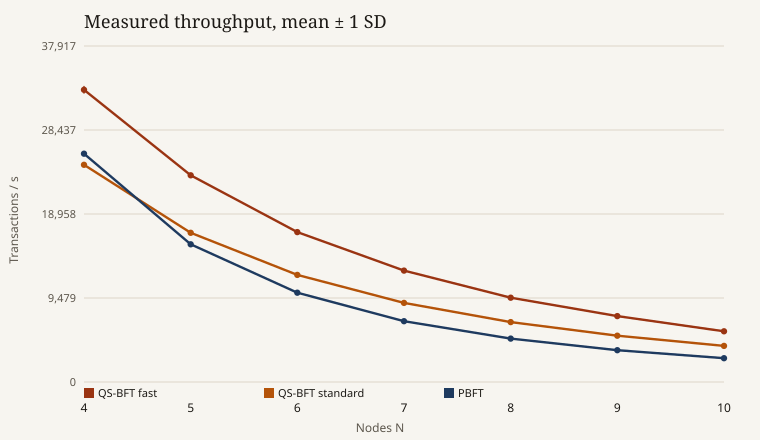
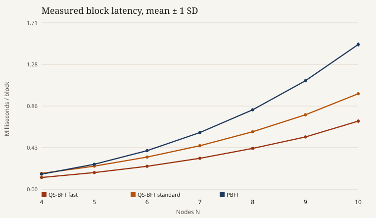

# QS-BFT

Written by Md Farhad Kabir. First published October 20, 2026. The preprint’s figures come from the Go testbed the preprint describes. This package is a standard-library Python 3 reference of the same algorithm and the same experiment sizes. Its figures are from this run and move with the host.

This is not the testbed code behind the preprint’s figures. There is no QKD hardware; keys are simulated random strings as in the preprint’s experiment.

DOI: [10.21203/rs.3.rs-9084418/v1](https://doi.org/10.21203/rs.3.rs-9084418/v1). The preprint PDF is [docs/preprint.pdf](docs/preprint.pdf).

Package version 1.0.0. The numbers in this file are the run stored in [benchmarks/results/evaluation.json](benchmarks/results/evaluation.json), produced by CPython 3.10.22 on `Linux-6.12.8+-x86_64-with-glibc2.36`.

## Reproduce

```bash
python3 -m unittest tests/test_qsbft.py
python3 benchmarks/run_benchmark.py
```

The standard library is sufficient. A fresh run rewrites the JSON, the CSV tables, and the two measured figures. Wall-clock figures move with the host.

## Where the preprint is implemented

| Preprint | This repository |
|---|---|
| Table 2: N, f = ⌊(N−1)/3⌋, K = N−1, δ = 1/2 + 1/3, with T1 < T2 − T | [src/qsbft/params.py](src/qsbft/params.py). M = 2^31−1, the implementation-specific prime. T = 3, T1 = 5, T2 = 9. |
| Equation (1), the multilinear family | `multilinear` in [src/qsbft/hashing.py](src/qsbft/hashing.py) |
| Definition 2, parametric hash | `parametric_hash`: the parametric hash uses the fixed public coefficient vector 3, 5, 7, 11, 13, 17, 19, 23. |
| MH-USS key distribution, Equations (7) and (8) | [src/qsbft/mhus.py](src/qsbft/mhus.py) |
| Algorithm 1, L = r mod N, fast and standard modes, empty-block vote | [src/qsbft/protocol.py](src/qsbft/protocol.py) |
| Experiment: N = 4…10, 1000 transactions, 10 runs, 256-byte transactions, 1024-byte blocks, MH-USS on both protocols, 256-bit simulated QKD keys | [src/qsbft/experiment.py](src/qsbft/experiment.py) |
| Theorem 4, quorum intersection | `quorum_intersection` |

## MH-USS

One signer and K verifiers. The signer draws K² field elements. Verifier P_i receives the slice of K keys that starts at index (i−1)K, then forwards the j-th element of that slice to P_j, which stores it as r_{i→j}.

Each distributed key is one field element. The tag checked with that element is Equation (1) on a one-chunk message with both key coefficients equal to the element: h(x) = r + r·x mod M. `sign` returns the K² tags of Equation (7). Verifier P_j accepts when the number of matching cross-checks is strictly greater than K·δ, which is Equation (8). δ = 5/6.

Timed runs draw each element from `secrets.token_bytes(32)`, reduced modulo M. That is the preprint's experimental key distribution: cryptographically random 256-bit strings, generated before the timer starts. A readable seeded schedule for K = 3 is [data/mhus_key_schedule_k3.json](data/mhus_key_schedule_k3.json). On that schedule every verifier accepts the honest signature.

Equation (8) on the tested grid:

| N | f | K | K·δ | Matches required | Mismatches tolerated |
|---:|---:|---:|---:|---:|---:|
| 4 | 1 | 3 | 2.5 | 3 | 0 |
| 5 | 1 | 4 | 3.333 | 4 | 0 |
| 6 | 1 | 5 | 4.167 | 5 | 0 |
| 7 | 2 | 6 | 5 | 6 | 0 |
| 8 | 2 | 7 | 5.833 | 6 | 1 |
| 9 | 2 | 8 | 6.667 | 7 | 1 |
| 10 | 3 | 9 | 7.5 | 8 | 1 |

For K ≤ 6 the threshold admits no bad tag. For K = 7, 8, and 9 it admits one. In every row that is fewer than f.

## Algorithm 1

The primary of round r is L = r mod N. The client sends REQUEST. L broadcasts PRE-PREPARE carrying the parametric hash h(p). Each secondary returns VOTE h(p), or an empty vote if PRE-PREPARE does not check. The primary's own proposal counts as a vote for h(p).

Fast mode runs when the vote total reaches 3f+1. The constants satisfy T1 < T2 − T, so the fast window is open for that quorum. L broadcasts FAST-RESOLVE, secondaries return a resolution vote, and FEEDBACK follows. Standard mode is the other branch of Algorithm 1: PRE-COMMIT and PRE-RESOLVE, then FEEDBACK if at least f+1 resolution votes support the block and the commit quorum 2f+1 was reached. Otherwise the round commits an empty block. A silent primary never broadcasts; the secondaries exchange empty votes. If at least 2f+1 secondaries are present, the round commits empty. That is the liveness case used for Theorem 5, in place of a PBFT view-change.

Send counts taken from those steps:

| N | f | 3f+1 | Fast messages 1+5(N−1) | Standard messages 1+7(N−1) | PBFT normal (N−1)+2N(N−1) | PBFT view-change N³ | PBFT / fast |
|---:|---:|---:|---:|---:|---:|---:|---:|
| 4 | 1 | 4 | 16 | 22 | 27 | 64 | 1.688 |
| 5 | 1 | 4 | 21 | 29 | 44 | 125 | 2.095 |
| 6 | 1 | 4 | 26 | 36 | 65 | 216 | 2.500 |
| 7 | 2 | 7 | 31 | 43 | 90 | 343 | 2.903 |
| 8 | 2 | 7 | 36 | 50 | 119 | 512 | 3.306 |
| 9 | 2 | 7 | 41 | 57 | 152 | 729 | 3.707 |
| 10 | 3 | 10 | 46 | 64 | 189 | 1000 | 4.109 |

## Quorum intersection

Theorem 4 is stated for N = 3f + 1. On this grid that is N = 4, 7, and 10. Every pair of commit quorums was enumerated. The minimum intersection is f + 1, and the number of failing pairs is zero.

| N | f | Quorum | Sets | Pairs | Minimum intersection | f+1 | Pairs below f+1 |
|---:|---:|---:|---:|---:|---:|---:|---:|
| 4 | 1 | 3 | 4 | 6 | 2 | 2 | 0 |
| 7 | 2 | 5 | 21 | 210 | 3 | 3 | 0 |
| 10 | 3 | 7 | 120 | 7140 | 4 | 4 | 0 |

## Experiment

The preprint's testbed is Go 1.21, goroutines, loopback TCP, an Intel Core i7-11700, 16 GB of RAM, and Ubuntu 22.04. This package is a Python 3 reference of the same algorithm and the same experiment sizes. Figures 4 and 5 of the preprint are plots without a numeric table. The curves below are this run, not a tracing of those figures.

One run builds 1000 transactions of 256 bytes (seeded payment records in [data/transactions.csv](data/transactions.csv) and the raw bytes in [data/transactions.bin](data/transactions.bin)). They pack into 250 blocks of 1024 bytes, four transactions each ([data/blocks.csv](data/blocks.csv), [data/blocks.bin](data/blocks.bin)). The block file is that transaction byte string in order, so the two binary SHA-256 values match. Both protocols sign the SHA-256 digest of each block with the same MH-USS instance. The timer starts after the keys and the blocks exist. It covers one signature per protocol message and one verification per receiver:

- QS-BFT fast follows the six Algorithm 1 sends: REQUEST, PRE-PREPARE, VOTE, FAST-RESOLVE, resolution VOTE, FEEDBACK.
- QS-BFT standard adds PRE-COMMIT and PRE-RESOLVE and their vote rounds.
- PBFT is PRE-PREPARE plus all-to-all PREPARE and all-to-all COMMIT.

N runs from 4 to 10. Each cell is 10 independent key schedules.

### Throughput

Transactions per second, mean ± sample standard deviation.

| N | QS-BFT fast | QS-BFT standard | PBFT | Fast / PBFT | Standard / PBFT |
|---:|---:|---:|---:|---:|---:|
| 4 | 32970.9 ± 442.7 | 24512.5 ± 233.2 | 25760.1 ± 252.6 | 1.280 | 0.952 |
| 5 | 23324.2 ± 264.6 | 16831.5 ± 93.0 | 15540.0 ± 55.8 | 1.501 | 1.083 |
| 6 | 16920.2 ± 72.4 | 12089.0 ± 77.5 | 10077.4 ± 35.9 | 1.679 | 1.200 |
| 7 | 12574.2 ± 40.9 | 8930.0 ± 41.7 | 6856.4 ± 37.7 | 1.834 | 1.302 |
| 8 | 9517.7 ± 82.2 | 6763.4 ± 27.6 | 4896.4 ± 17.4 | 1.944 | 1.381 |
| 9 | 7436.2 ± 50.5 | 5225.7 ± 37.7 | 3586.0 ± 37.9 | 2.074 | 1.457 |
| 10 | 5717.9 ± 163.4 | 4073.8 ± 48.2 | 2688.4 ± 41.6 | 2.127 | 1.515 |



Fast mode is above PBFT at every tested N. The ratio moves from 1.280 at N = 4 to 2.127 at N = 10. The Algorithm 1 send ratio, PBFT normal over fast, is 1.688 at N = 4 and 4.109 at N = 10. The timed ratio lies between those readings: each MH-USS signature does K² field multiplications, and K = N−1, so the cost of a signature grows as the network grows.

Standard mode is below PBFT at N = 4 (ratio 0.952) and above PBFT from N = 5 to N = 10.

### Block latency

Milliseconds per 1024-byte block, mean ± sample standard deviation. A block holds four transactions, so the per-transaction figure is one quarter of the block figure.

| N | QS-BFT fast | QS-BFT standard | PBFT |
|---:|---:|---:|---:|
| 4 | 0.1213 ± 0.0017 | 0.1632 ± 0.0016 | 0.1553 ± 0.0015 |
| 5 | 0.1715 ± 0.0019 | 0.2377 ± 0.0013 | 0.2574 ± 0.0009 |
| 6 | 0.2364 ± 0.0010 | 0.3309 ± 0.0021 | 0.3969 ± 0.0014 |
| 7 | 0.3181 ± 0.0010 | 0.4479 ± 0.0021 | 0.5834 ± 0.0032 |
| 8 | 0.4203 ± 0.0036 | 0.5914 ± 0.0024 | 0.8169 ± 0.0029 |
| 9 | 0.5379 ± 0.0037 | 0.7655 ± 0.0056 | 1.1156 ± 0.0118 |
| 10 | 0.7001 ± 0.0213 | 0.9820 ± 0.0117 | 1.4882 ± 0.0230 |



### Multilinear hash against Toeplitz

The preprint states that the multilinear family is about 8× faster than the Toeplitz hash used by the earlier LC signature. A Toeplitz product of width n does n² multiplications. Equation (1) does n. The operation ratio at width 8 is therefore 8. The timed ratio on this interpreter, 2000 repetitions, modulus 2^31−1:

| Width | Multilinear multiplications | Toeplitz multiplications | Operation ratio | Measured time ratio |
|---:|---:|---:|---:|---:|
| 4 | 4 | 16 | 4 | 4.345 |
| 8 | 8 | 64 | 8 | 9.838 |
| 16 | 16 | 256 | 16 | 19.764 |
| 32 | 32 | 1024 | 32 | 46.530 |

At width 8 the measured ratio is 9.838.

### Parametric hash

One 1024-byte block, 256 single-bit input flips, output reduced to 31 bits. Mean fraction of output bits that change: 0.5019 (minimum 0.2581, maximum 0.7419). The preprint describes an avalanche of about one half.

Definition 1 was checked exactly for one-chunk messages over the prime field of order 17. Every value has 17 preimage keys, and every pair of distinct messages has joint preimage size 1, which is the strong-universality count |H|/|Y|².

### A 250-round trace at N = 4

[data/consensus_trace_n4.csv](data/consensus_trace_n4.csv) runs Algorithm 1 on the 250 blocks. Round 3 uses a silent primary and commits an empty block. The other 249 rounds commit in fast mode. Message count on a fast round is 16, which is 1+5·3. One locked value is recorded on every round.

## Files

| Path | Role | SHA-256 |
|---|---|---|
| `data/transactions.csv` | 106779 bytes | `155c99a6c74ee710df475acc298dbce0001515c48615a0401255ad66e5a53ff9` |
| `data/transactions.bin` | 256000 bytes | `01a4e09f1a808d34ccb22495d3b54d53e22443717b2196c8147ec62dacb3407a` |
| `data/blocks.csv` | 22999 bytes | `fb57e9d2c6becf727802ab96cbf0884dcfe2f5683a32be93788ba7e84ecd67e7` |
| `data/blocks.bin` | 256000 bytes | `01a4e09f1a808d34ccb22495d3b54d53e22443717b2196c8147ec62dacb3407a` |
| `data/consensus_trace_n4.csv` | 6206 bytes | `83a27068b3958a5c8a75727b7dc50b2d5b3a4bfd5483234a74312a3b7181e429` |
| `data/mhus_key_schedule_k3.json` | 819 bytes | `c221a5f5bdffdca90729cc7dd99c75c3e9b9aea9731ae50189fef2f862ab09fc` |
| `benchmarks/results/evaluation.json` | 74142 bytes | `fa1f2e00bd7a7d5cce0c33b12dfd9d946d852f4f27446b59627d422406361c3d` |
| `benchmarks/results/summary.csv` | 2069 bytes | `c736dd69f343197294f718f9f401cbb3d1f8435c87b9e0351b9e3908cb0fa81d` |
| `benchmarks/results/runs.csv` | 18652 bytes | `a9ab2d1110d628a6567674b25725ff53b588d8cd5a8d245d981dc6271698fa25` |
| `benchmarks/results/complexity.csv` | 839 bytes | `2a3d5d3360ed4aec68980ed5f8b8f83b8d636f2e05247c5b2e6a3aec351c8ecf` |
| `benchmarks/results/safety.csv` | 351 bytes | `eda64dd6aa68ad8cd6912a1e7e6f23c15f026768ab2005337a1484ac509d836b` |
| `benchmarks/results/thresholds.csv` | 252 bytes | `97c3bc13045229786070da485d7b48db3efcbb80155956df11d6000d7dafcf6e` |
| `benchmarks/results/hash_race.csv` | 452 bytes | `3e94cef1b20693dd6b262ee603459817937ca5a7d94738b101786864b25e1faf` |
| `docs/preprint.pdf` | 637801 bytes | `7997716667897dccaa49942f49753d2d51b6f9850ba53b178b87a59d6d0ac49a` |

```
src/qsbft/params.py       Table 2
src/qsbft/hashing.py      Equations (1)–(3) and the cubic parametric hash
src/qsbft/mhus.py         MH-USS key schedule, sign, verify
src/qsbft/protocol.py     Algorithm 1 and the quorum check
src/qsbft/experiment.py   1000 × 256-byte payments, 1024-byte blocks, timings
benchmarks/run_benchmark.py
tests/test_qsbft.py
docs/preprint.pdf
docs/figures/architecture.svg
docs/figures/throughput.svg
docs/figures/latency.svg
```


## Citation

Cite the preprint. [CITATION.cff](CITATION.cff) carries the seven authors and the DOI. The software license is MIT ([LICENSE](LICENSE)). The preprint is distributed by its authors under Creative Commons Attribution 4.0.
